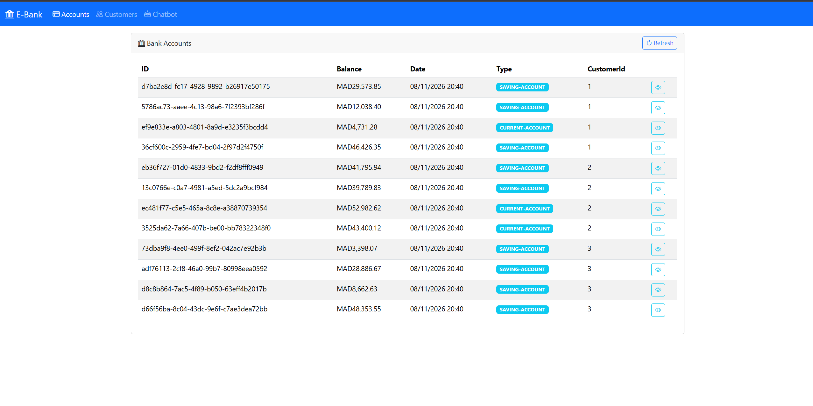
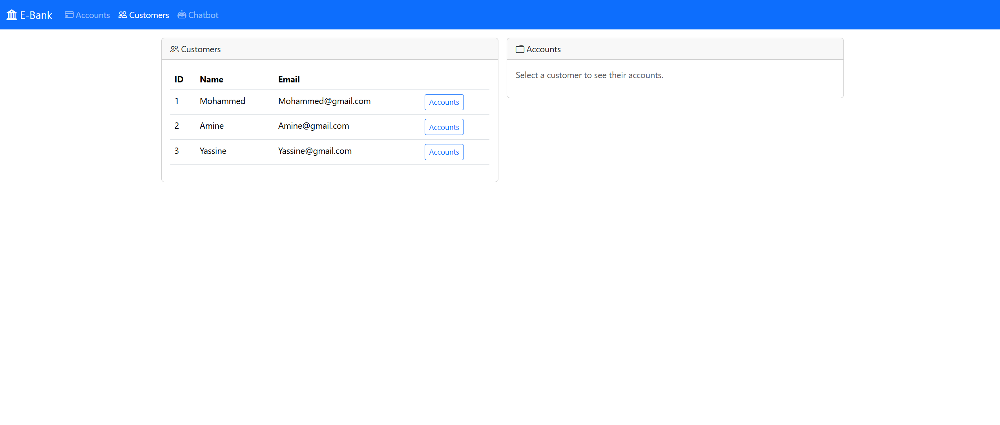
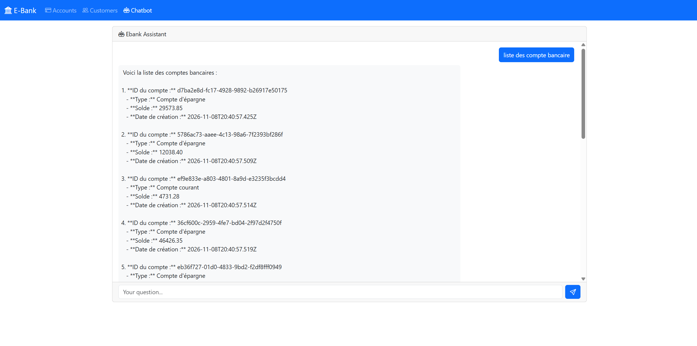
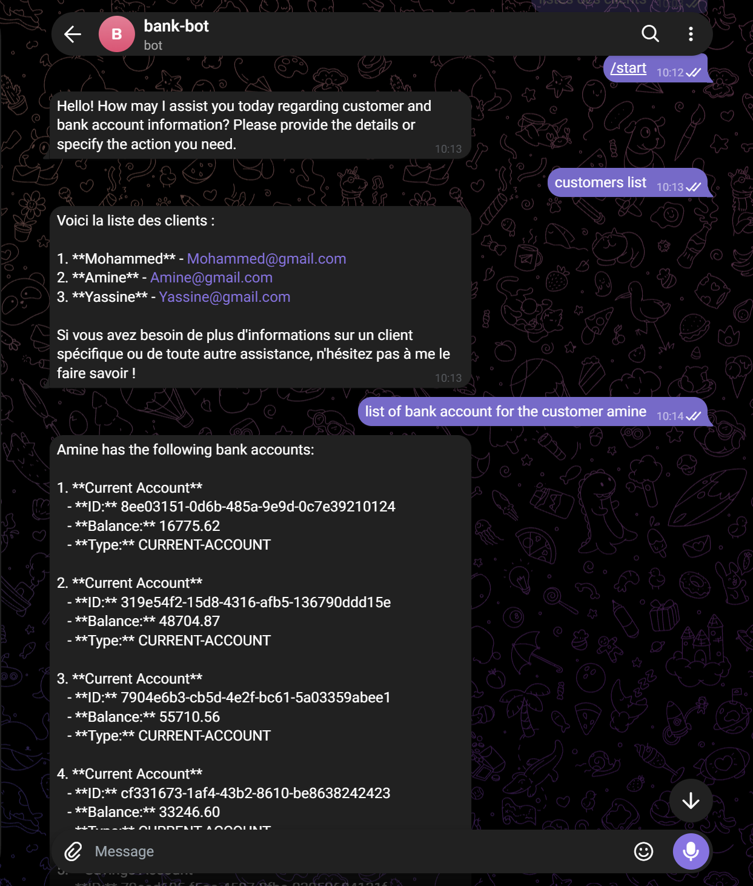
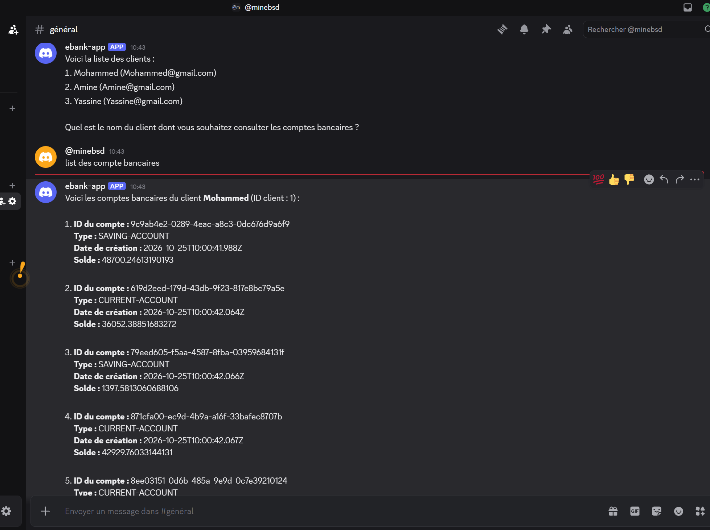

# E-Bank — Architecture Micro-services avec Spring Cloud, Spring AI, MCP et Angular

Application bancaire construite en **micro-services**. Elle gère des **clients** et leurs **comptes bancaires**, et propose un **assistant conversationnel (IA)**. Cet assistant interroge les micro-services via le protocole **MCP (Model Context Protocol)**. On peut lui parler depuis une interface **Angular**, sur **Telegram** ou sur **Discord**.

---

## Sommaire

- [Architecture](#architecture)
- [Technologies](#technologies)
- [Les micro-services](#les-micro-services)
- [Front-end Angular](#front-end-angular)
- [Lancer le projet](#lancer-le-projet)
- [Captures d'écran](#captures-décran)
- [Structure du projet](#structure-du-projet)

---

## Architecture

```
                         ┌──────────────────────┐
                         │  discovery-service   │
                         │   Eureka  (8761)     │
                         └──────────▲───────────┘
                                    │ enregistrement / découverte
        ┌───────────────┬───────────┼───────────────┬──────────────────┐
        │               │           │               │                  │
┌───────┴──────┐ ┌──────┴───────┐ ┌─┴─────────────┐ ┌┴─────────────────┐
│ angular-front│ │gateway-service│ │customer-service│ │  ebank-service   │
│   (4200)     │─▶│ Spring Cloud │─▶│    (8082)     │◀─│     (8083)       │
└──────────────┘ │ Gateway(9999)│ │ H2 · MCP server│ │ H2 · Feign ·     │
                 └──────┬───────┘ └───────▲────────┘ │ Resilience4j ·   │
                        │                 │          │ MCP server       │
                        │                 │ MCP      └────────▲─────────┘
                        │         ┌───────┴──────────┐        │ MCP
                        └────────▶│    ebank-bot     │────────┘
                                  │ Spring AI (8050) │
                                  │ Ollama / OpenAI  │
                                  │ Telegram·Discord │
                                  └──────────────────┘
```

- Le **front Angular** passe toujours par la **gateway** (`http://localhost:9999/<NOM-SERVICE>/...`).
- La **gateway** trouve les services dans **Eureka** et crée les routes automatiquement (`DiscoveryClientRouteDefinitionLocator`).
- **ebank-service** appelle **customer-service** avec **OpenFeign**. Un **circuit breaker** (Resilience4j) renvoie un client par défaut si customer-service ne répond pas.
- **customer-service** et **ebank-service** sont aussi des **serveurs MCP** : leurs méthodes annotées `@McpTool` deviennent des outils que l'IA peut appeler.
- **ebank-bot** est un **client MCP**. L'agent Spring AI choisit tout seul les outils à appeler pour répondre à la question de l'utilisateur.

---

## Technologies

| Couche            | Technologies                                                                                             |
| ----------------- | -------------------------------------------------------------------------------------------------------- |
| Back-end          | Java 21, Spring Boot 4.1.1, Spring Data JPA, H2, Lombok                                                  |
| Micro-services    | Spring Cloud 2025.1.3 : Eureka, Gateway (WebFlux), OpenFeign, Circuit Breaker Resilience4j               |
| IA                | Spring AI 2.0.1, MCP Server / MCP Client (streamable HTTP), Ollama (`granite4.1:8b`) ou OpenAI / Groq    |
| Bots              | Telegram (`telegrambots-spring-boot-starter`), Discord (`spring-boot-starter-discord` / JDA)             |
| Documentation API | springdoc-openapi (Swagger UI)                                                                           |
| Front-end         | Angular 22 (standalone components, control flow `@if/@for`, signals), Bootstrap 5, Bootstrap Icons, RxJS |

---

## Les micro-services

### 1. `discovery-service` — port 8761

Serveur **Eureka** (`@EnableEurekaServer`). Tous les autres services s'y enregistrent.

### 2. `gateway-service` — port 9999

**Spring Cloud Gateway**. Les routes sont créées dynamiquement à partir d'Eureka, au format `/{SERVICE-ID}/**` :

- `http://localhost:9999/CUSTOMER-SERVICE/customers`
- `http://localhost:9999/EBANK-SERVICE/accounts`
- `http://localhost:9999/EBANK-BOT/chat?query=...`

Le **CORS** global est configuré dans `application.yaml` pour que le front Angular puisse appeler la gateway.

### 3. `customer-service` — port 8082

Gère les clients (`id`, `name`, `email`). Trois clients sont créés au démarrage : Mohammed, Amine et Yassine.

| Méthode | Endpoint          | Description          |
| ------- | ----------------- | -------------------- |
| GET     | `/customers`      | Liste des clients    |
| GET     | `/customers/{id}` | Un client par son id |
| POST    | `/customers`      | Créer un client      |

Outils MCP exposés : `getAllCustomers`, `getCustomerById`, `saveCustomer`.

### 4. `ebank-service` — port 8083

Gère les comptes bancaires (`id` UUID, `balance`, `createdAt`, `type`, `customerId`). Au démarrage, 4 comptes sont créés pour chacun des 3 clients.

| Méthode | Endpoint                  | Description                                       |
| ------- | ------------------------- | ------------------------------------------------- |
| GET     | `/accounts`               | Liste des comptes                                 |
| GET     | `/accounts/{id}`          | Un compte, avec son client récupéré via Feign     |
| GET     | `/accounts/customer/{id}` | Les comptes d'un client                           |
| POST    | `/accounts`               | Créer un compte (`balance`, `type`, `customerId`) |

- **OpenFeign** : `CustomerRestClient` appelle `customer-service` par son nom dans Eureka.
- **Resilience4j** : si `customer-service` est indisponible, la méthode `getDefaultCustomer` renvoie un client par défaut.
- **Console H2** : `http://localhost:8083/h2-console` (JDBC URL : `jdbc:h2:mem:accounts-db`).

### 5. `ebank-bot` — port 8050

Agent conversationnel **Spring AI** (`EbankAiAgent`) :

- **ChatClient**, avec un _system prompt_ qui oblige le modèle à toujours utiliser les outils et à ne jamais inventer d'identifiant ;
- une **mémoire de conversation** (`MessageChatMemoryAdvisor`), séparée pour chaque canal (REST, Telegram ou Discord) ;
- des **outils MCP** fournis par `customer-service` et `ebank-service`.

Canaux disponibles :

| Canal                                   | Activation                                                                    |
| --------------------------------------- | ----------------------------------------------------------------------------- |
| REST `GET /chat?query=...` (texte brut) | toujours actif, utilisé par le front Angular                                  |
| Telegram                                | si la variable `TELEGRAM_TOKEN` est définie (le bot accepte aussi les images) |
| Discord                                 | avec le profil Spring `discord` et la variable `DISCORD_TOKEN`                |

Modèle LLM : par défaut **Ollama en local** (`granite4.1:8b`). Une configuration **Groq / OpenAI** est disponible en commentaire dans `application.properties`.

---

## Front-end Angular

Le dossier `angular-front/` contient une application Angular 22 en _standalone components_.

| Route           | Composant        | Description                                                                   |
| --------------- | ---------------- | ----------------------------------------------------------------------------- |
| `/accounts`     | `Accounts`       | Tableau des comptes, avec états _loading / error / success_ et bouton Refresh |
| `/accounts/:id` | `AccountDetails` | Détail d'un compte et de son client                                           |
| `/customers`    | `Customers`      | Liste des clients ; un clic sur un client affiche ses comptes                 |
| `/chat`         | `Chat`           | Interface de chat avec l'assistant IA (`ebank-bot`)                           |

- **Services** : `AccountService`, `CustomerService` et `ChatService`. Les URLs de la gateway sont définies dans `services/api.config.ts`.
- **Gestion d'état** : chaque requête produit un `Observable<DataState<T>>` (`startWith(LOADING)` → `map(SUCCESS)` → `catchError(ERROR)`), affiché avec le pipe `async`.

---

## Lancer le projet

### Prérequis

- **JDK 21**
- **Node.js** et **npm** (pour Angular)
- **Ollama** avec le modèle utilisé par le bot :
  ```bash
  ollama pull granite4.1:8b
  ollama serve
  ```

### Démarrage du back-end (dans cet ordre)

Chaque service est un projet Maven indépendant. Ouvre un terminal par service :

```powershell
cd discovery-service; .\mvnw.cmd spring-boot:run   # 1. Eureka         :8761
cd customer-service;  .\mvnw.cmd spring-boot:run   # 2. Clients        :8082
cd ebank-service;     .\mvnw.cmd spring-boot:run   # 3. Comptes        :8083
cd ebank-bot;         .\mvnw.cmd spring-boot:run   # 4. Chatbot IA     :8050
cd gateway-service;   .\mvnw.cmd spring-boot:run   # 5. Gateway        :9999
```

Pour activer les bots Telegram et Discord :

```powershell
$env:TELEGRAM_TOKEN="<token>"; $env:DISCORD_TOKEN="<token>"
.\mvnw.cmd spring-boot:run "-Dspring-boot.run.profiles=discord"
```

> Sous Linux ou macOS, utilise `./mvnw spring-boot:run`.

### Démarrage du front-end

```bash
cd angular-front
npm install
npm start
```

Ouvre ensuite **http://localhost:4200**.

### Vérification

| URL                                                              | Ce que tu dois voir                                      |
| ---------------------------------------------------------------- | -------------------------------------------------------- |
| http://localhost:8761                                            | Le tableau de bord Eureka, avec les services enregistrés |
| http://localhost:9999/CUSTOMER-SERVICE/customers                 | La liste des clients via la gateway                      |
| http://localhost:9999/EBANK-SERVICE/accounts                     | La liste des comptes via la gateway                      |
| http://localhost:9999/EBANK-BOT/chat?query=liste%20des%20clients | Une réponse de l'assistant IA                            |
| http://localhost:8083/swagger-ui.html                            | La documentation Swagger de ebank-service                |

---

## Captures d'écran

### Front Angular — Liste des comptes



### Front Angular — Clients



### Front Angular — Chatbot IA



### Bot Telegram



### Bot Discord



---

## Structure du projet

```
ebank-ms-app/
├── discovery-service/      # Serveur Eureka
├── gateway-service/        # Spring Cloud Gateway
├── customer-service/       # Gestion des clients + serveur MCP
├── ebank-service/          # Gestion des comptes + Feign + Resilience4j + serveur MCP
├── ebank-bot/              # Agent Spring AI + client MCP + bots Telegram et Discord
├── angular-front/          # Front-end Angular
│   └── src/app/
│       ├── accounts/           # Liste des comptes
│       ├── account-details/    # Détail d'un compte
│       ├── customers/          # Clients et leurs comptes
│       ├── chat/               # Chatbot
│       ├── model/              # Interfaces TypeScript
│       └── services/           # Services HTTP
└── screenshots/            # Captures d'écran
```

---
